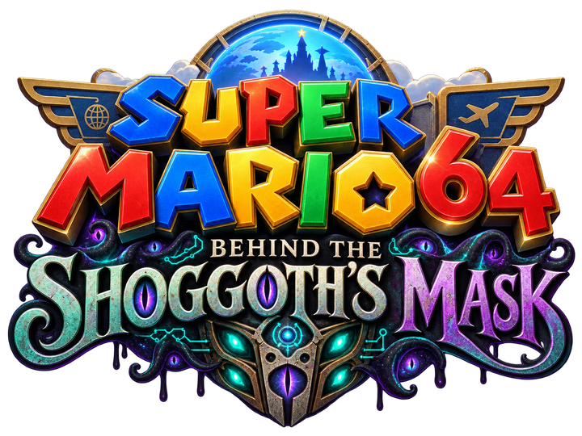
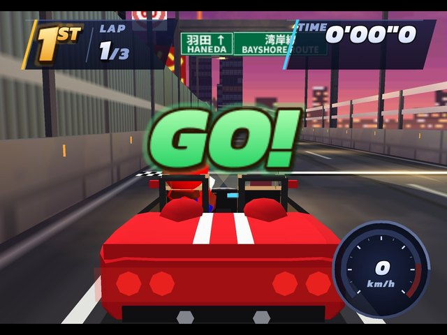
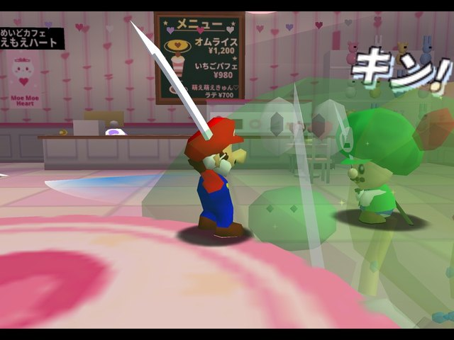
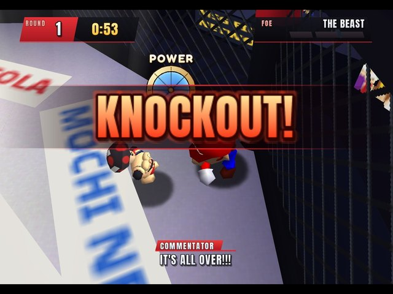
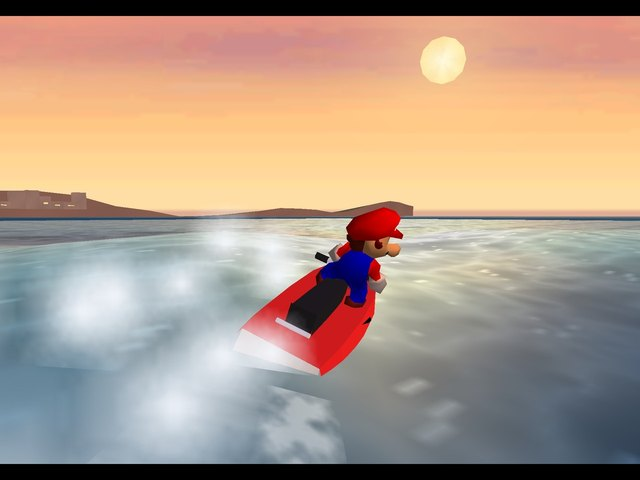
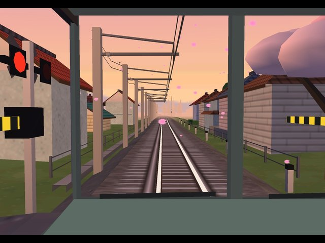
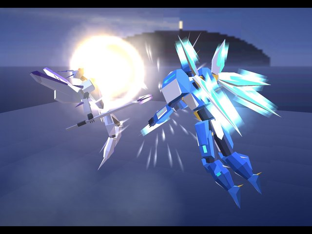

  

  <b>A Super Mario 64 romhack: Tokyo, Paris and New York, built at Mario's scale.</b> 
  Demo 1 · 27 stars · beginner friendly

  <a href="https://github.com/supermochi64/behind-the-shoggoths-mask/releases/latest"><b>⬇ Download the latest patch</b></a>
  &nbsp;·&nbsp;
  <a href="https://youtu.be/XR1BV0Syj4Y">▶ Trailer</a>
  &nbsp;·&nbsp;
  <a href="https://youtu.be/Md7wudx3RzA">▶ Best moments</a>
  &nbsp;·&nbsp;
  <a href="https://forms.gle/xHgsKC5nwx7R4DWW7">📝 Feedback</a>

---

**Peach International Starport is open.** Step through a Star Gate and you're in Tokyo, Paris or New York, each one packed with its own way to play. A friendly AI assistant called M.O.C.H.I. runs the gates, the boards and the weather, and keeps the whole network running smoothly.

*Nothing to worry about.*

I'm building this hack on my own, with one stupidly ambitious goal: to make the best SM64 romhack ever. This first demo is out early on purpose, so your feedback can shape where it goes next.

    
    

## How to play

You need **your own clean Super Mario 64 (USA) ROM** in `.z64` format. I don't distribute ROMs: this repo only has a patch, which turns your ROM into the hack.

1. **Download** `SM64-Shoggoth.bps` from the [latest release](https://github.com/supermochi64/behind-the-shoggoths-mask/releases/latest).
2. **Patch your ROM** in your browser with [Rom Patcher JS](https://www.marcrobledo.com/RomPatcher.js/): pick your Super Mario 64 (USA) `.z64` as the ROM file and `SM64-Shoggoth.bps` as the patch, then press *Apply patch*. You get the hack as a new `.z64`. (Any BPS patcher works, e.g. Floating IPS or beat.)
3. **Play it in [Parallel Launcher](https://parallel-launcher.ca)** (recommended) or any emulator that has the **GLideN64** graphics plugin. In Parallel Launcher, add the patched `.z64` and set its graphics plugin to **GLideN64**.

| | |
|---|---|
| Graphics plugin | **GLideN64** (tested in all 22 areas with Parallel Launcher's own core). Glide64 also works. |
| Not supported yet | ParaLLEl / Angrylion and real N64 hardware / EverDrive: some areas freeze there. I'm working on it. |
| Save type | EEPROM 4k (the default) |
| Your ROM | Super Mario 64 (USA), `.z64`, SHA-1 `9bef1128717f958171a4afac3ed78ee2bb4e86ce` |
| Patched result (v1.0.1) | SHA-1 `d5b308bef5c5309d158bea41c9edf81c37e6c947` |

**Star display:** [`star_layout.json`](star_layout.json) is a Parallel Launcher star layout (Tokyo, Paris, New York and the Starport's secret stars).

If the patcher complains, your ROM isn't the clean US version: check that it's `.z64` (not `.n64`/`.v64`) and compare its SHA-1 with the one above.

## What's in Demo 1

- **27 stars**: Tokyo (7), Paris (7), New York (7) and 6 secret stars hidden in the Starport
- **Every star plays differently**: race the Drift King down Tokyo's Shuto expressway, drive a commuter train, katana-duel cosplayers in a maid café, a totally legal yacht heist in Paris, box THE BEAST, drive through New York traffic, a shopping-cart race through Mall-Wart, climb a crane, the Eiffel Tower and a skyscraper
- **A giant-robot boss fight** over the Starport at night
- Kinoko Town and Peach International Starport as the hub, with day and night changing as you collect stars
- New music, a reworked camera (free camera with adjustable speed in the pause menu) and 3D-turning coins

The first worlds are deliberately **beginner friendly**: about as hard as the opening courses of the original game. Later worlds will ramp up.

## Feedback

This demo exists for your feedback, and the more specific, the better:

- **[Feedback form](https://forms.gle/xHgsKC5nwx7R4DWW7)** (3–5 minutes)
- **Bugs**: open an [issue](https://github.com/supermochi64/behind-the-shoggoths-mask/issues) with where it happened (city + what you were doing), your emulator and plugin, and a screenshot if you can
- Comments on [YouTube](https://youtu.be/Md7wudx3RzA) are great too

## Changelog

**v1.0.1** (2026-10-10)
- Maid café: the Mario cosplayer now walks up to Mario for his speech (he got stuck at the edge of the stage)
- Talk boxes appear and disappear cleanly (no more empty bar flashing as a box closes)

**v1.0** (2026-10-08): Demo 1, the first public release

## Credits

- Made by **mochi64**
- Reonucam: Reonu (via HackerSM64)
- 3D coin frames: Kaze Emanuar (Peach's Fury)
- Fonts: Google Fonts (SIL Open Font License)
- Built on the SM64 decompilation (n64decomp)

*Fan project. Not affiliated with or endorsed by Nintendo. No ROMs or Nintendo assets are distributed here: only a patch for your own copy of the game.*
